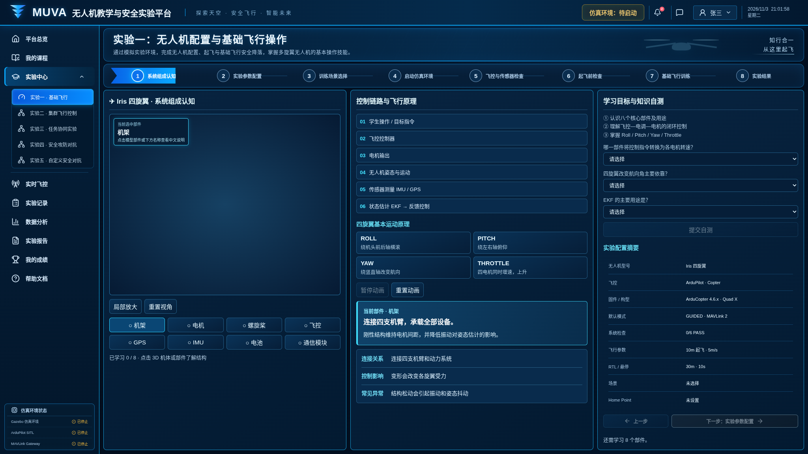
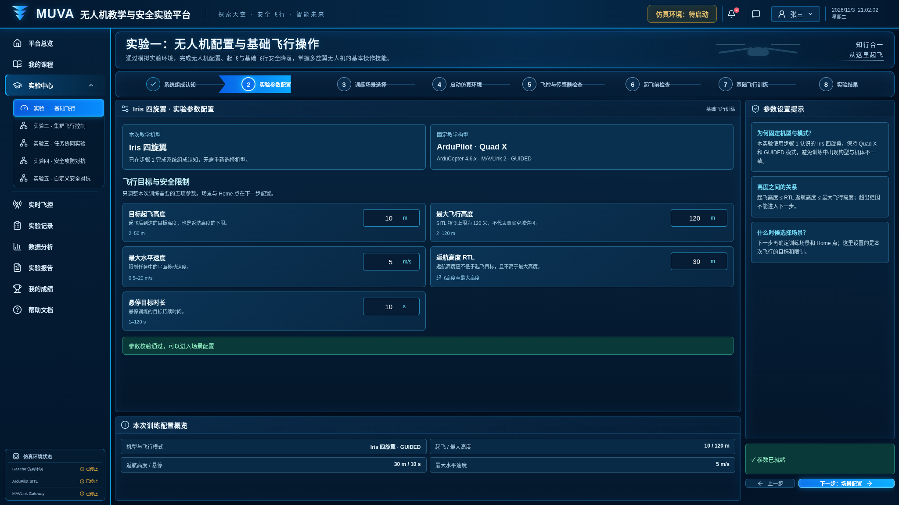
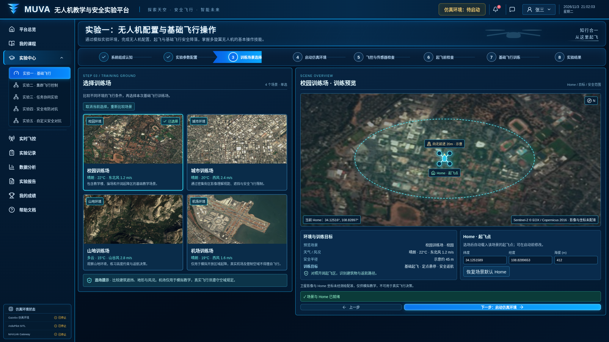
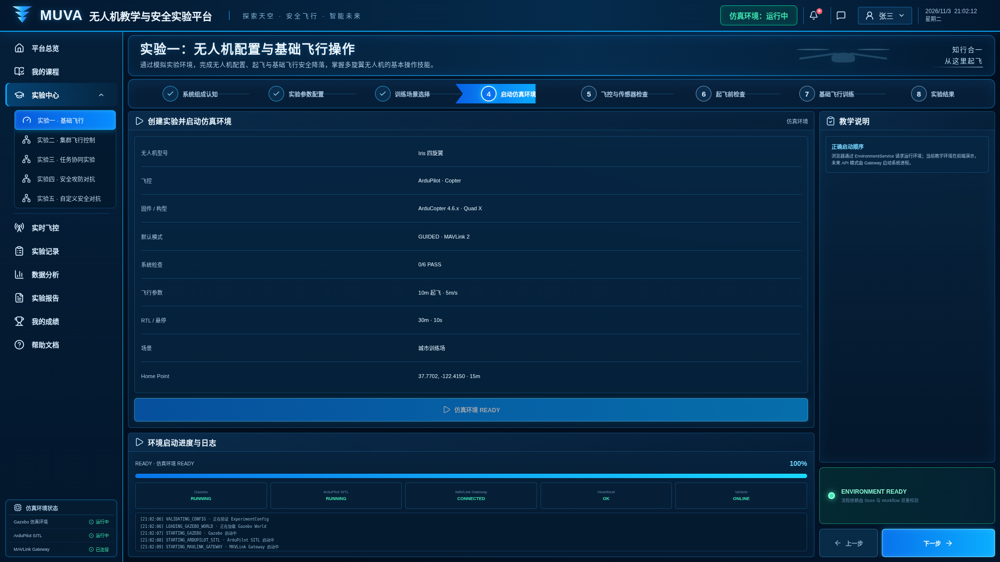
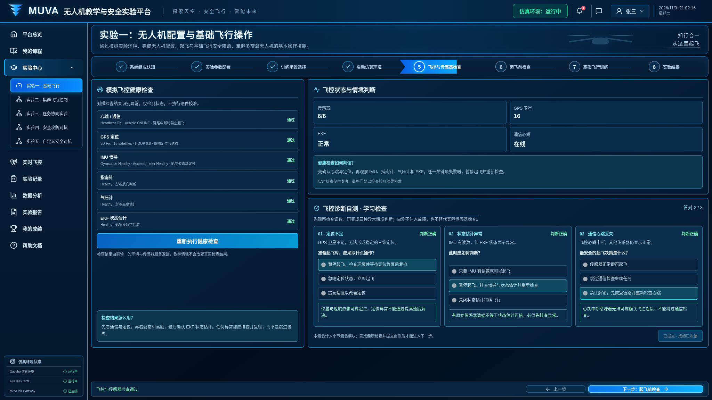
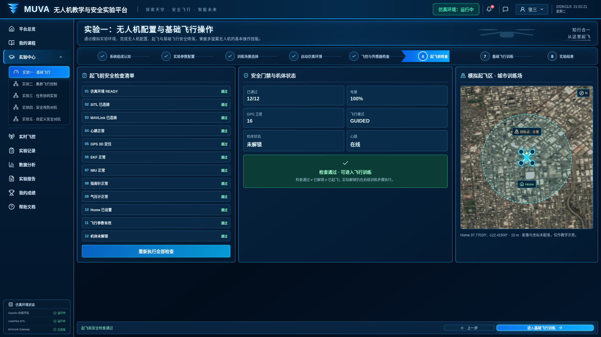
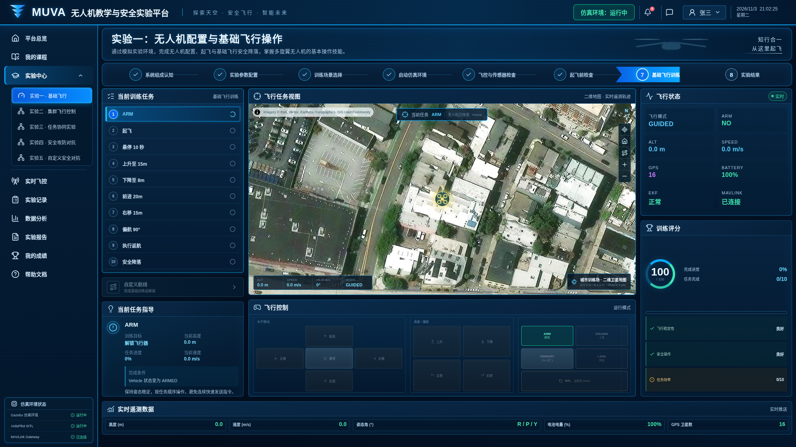
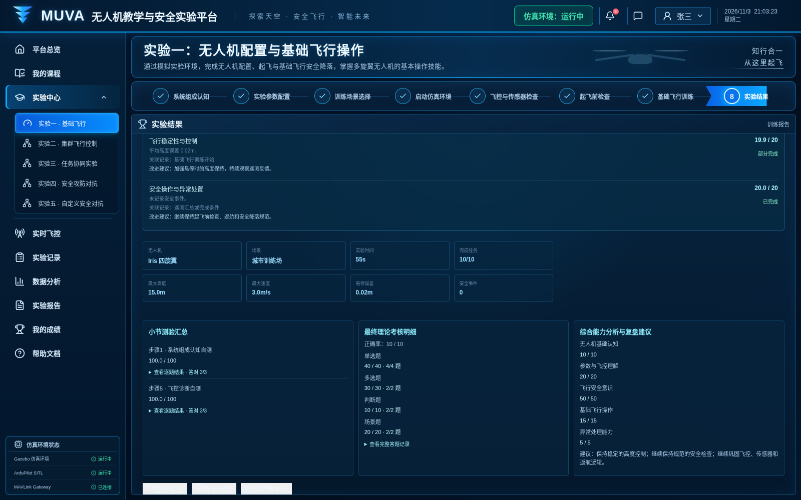

# 实验一：无人机配置与基础飞行

界面版本：2026 年 11 月 3 日。

入口：`/experiments/basic-flight`。先启动统一前端，再通过“登录学生端”进入实验中心。

[返回全部实验](../README.md) · [运行与依赖说明](../../../README.md)

## 步骤 1：系统组成学习与自测

阅读机体、动力、飞控、定位与通信等组成，完成自测后进入参数设置。

## 步骤 2：飞控参数设置

检查起飞高度、速度及安全边界，使用有效范围内的参数继续。

## 步骤 3：训练场景选择

选择校园、城市、山地或机场场景，确认场景信息。

## 步骤 4：运行环境检查

Mock 模式检查教学模拟环境；真实模式还需要 Gateway、SITL 与 Gazebo。

## 步骤 5：传感器检查

完成传感器诊断，检查通过后继续。

## 步骤 6：起飞前检查

确认连接、飞控、任务和安全条件，进入飞行训练。

## 步骤 7：基础飞行训练

依次完成解锁、起飞、升降、平移、转向、返航与降落。截图来自浏览器 Mock 实际运行。

## 步骤 8：理论考核与实验结果

完成理论考核，结算成绩并查看实验复盘。

