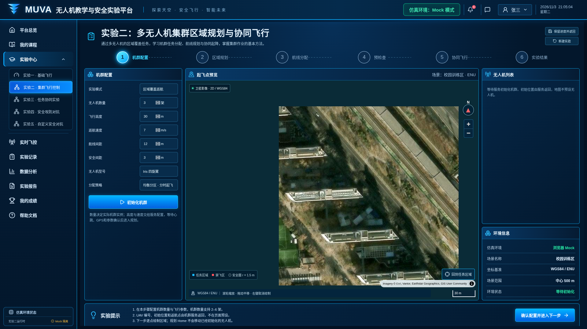
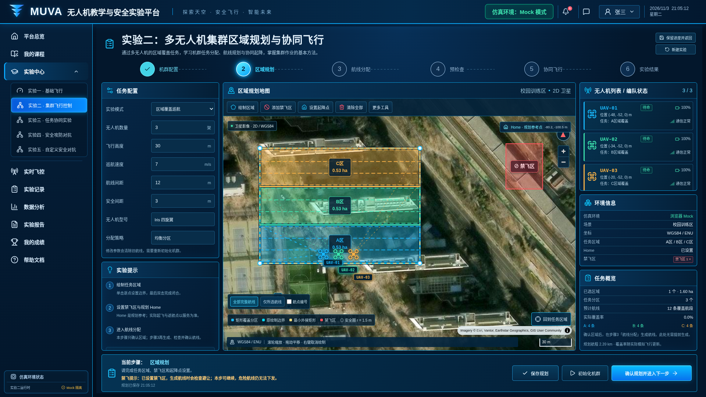
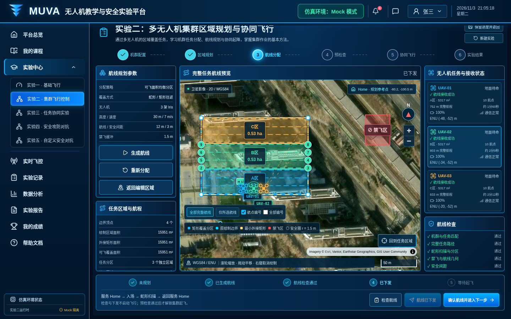
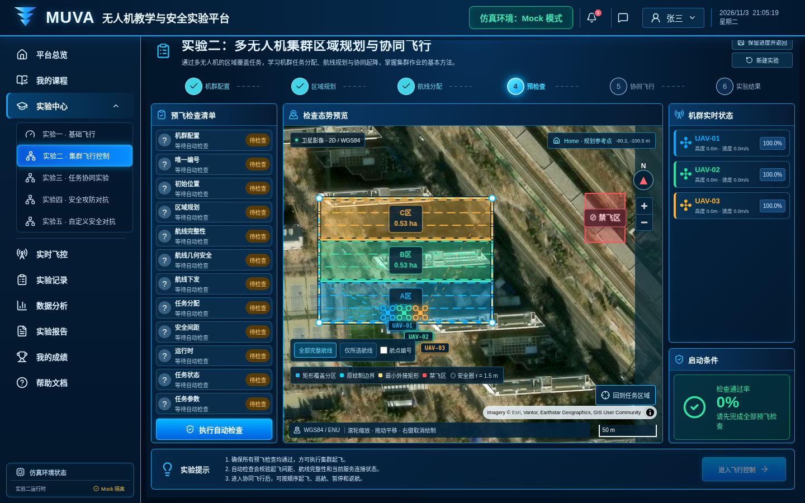
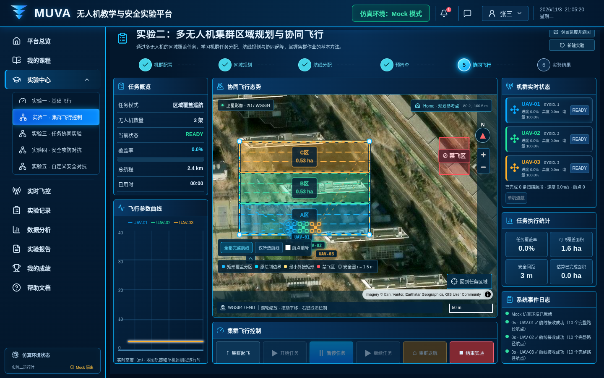
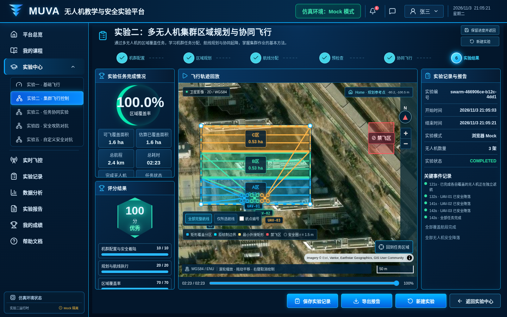

# 实验二：多无人机区域规划与协同飞行

界面版本：2026 年 11 月 3 日。

入口：`/experiments/swarm`。先启动统一前端，再通过“登录学生端”进入实验中心。

[返回全部实验](../README.md) · [运行与依赖说明](../../../README.md)

## 步骤 1：任务配置

新建实验并确认无人机数量、间距、高度和任务参数。

## 步骤 2：区域规划

绘制任务区域和禁飞区，初始化机群，生成并检查分区航线。

## 步骤 3：航线确认与下发

核对完整入场、扫描和返航航线，检查并下发，等待各机接收回执。

## 步骤 4：起飞前检查

执行检查，确认航线接收成功后进入飞行控制。

## 步骤 5：协同飞行控制

集群起飞后开始任务，查看各机状态、覆盖进度与轨迹。

## 步骤 6：实验结果

任务结束并安全返航后保存实验记录。截图为 Mock 运行结果；真实多机执行需独立 Gateway、SITL 与 Gazebo。

