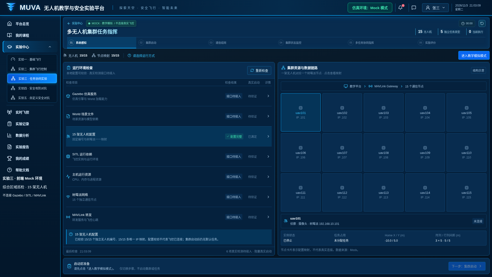
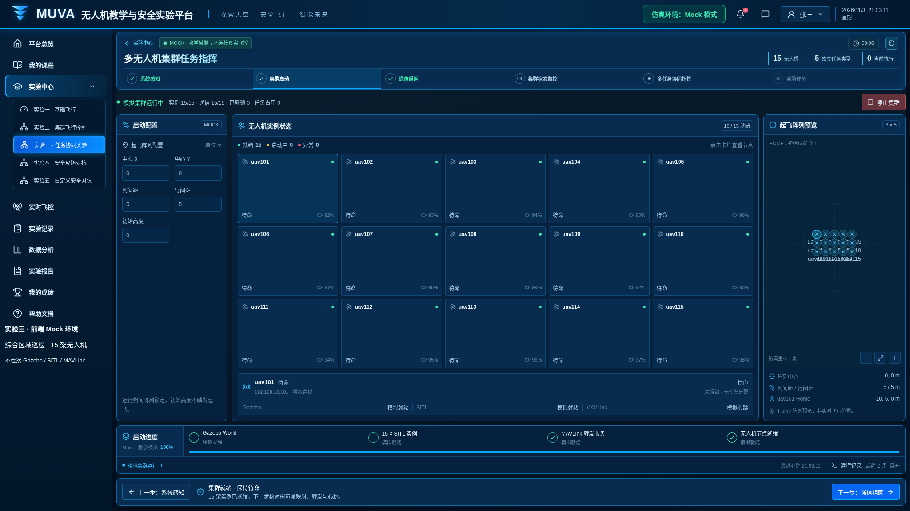
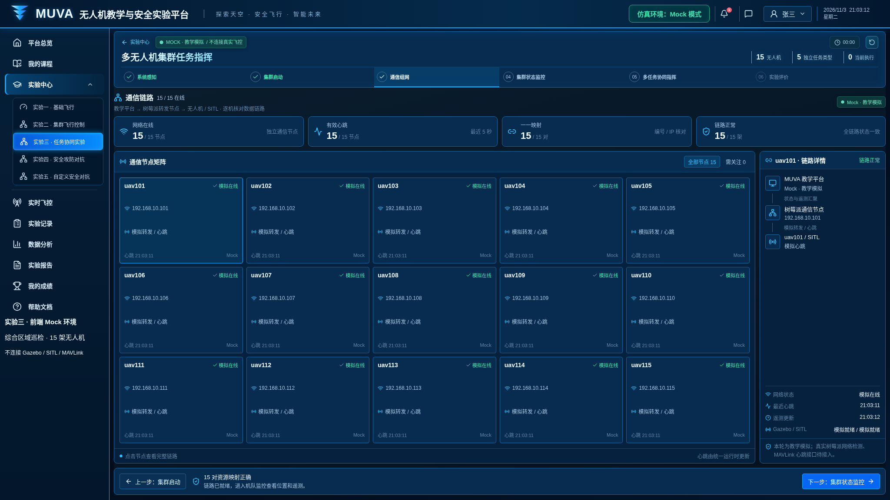
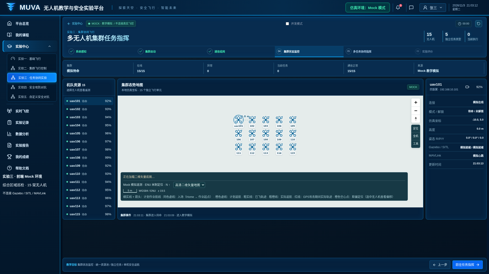
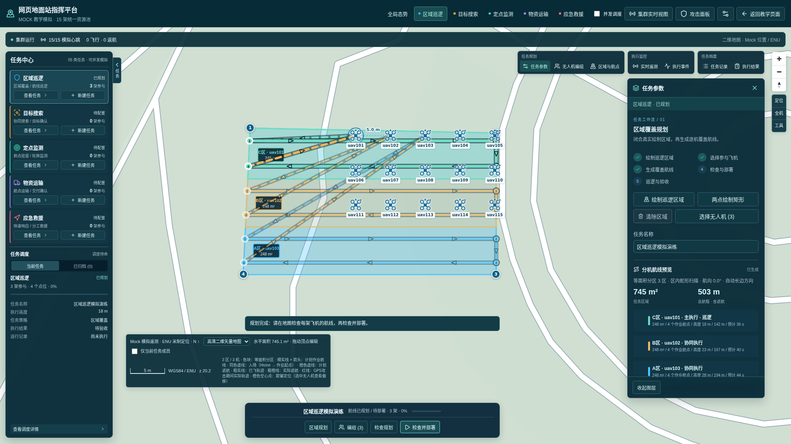
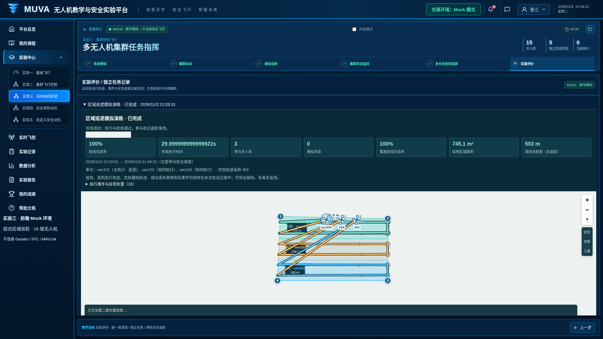
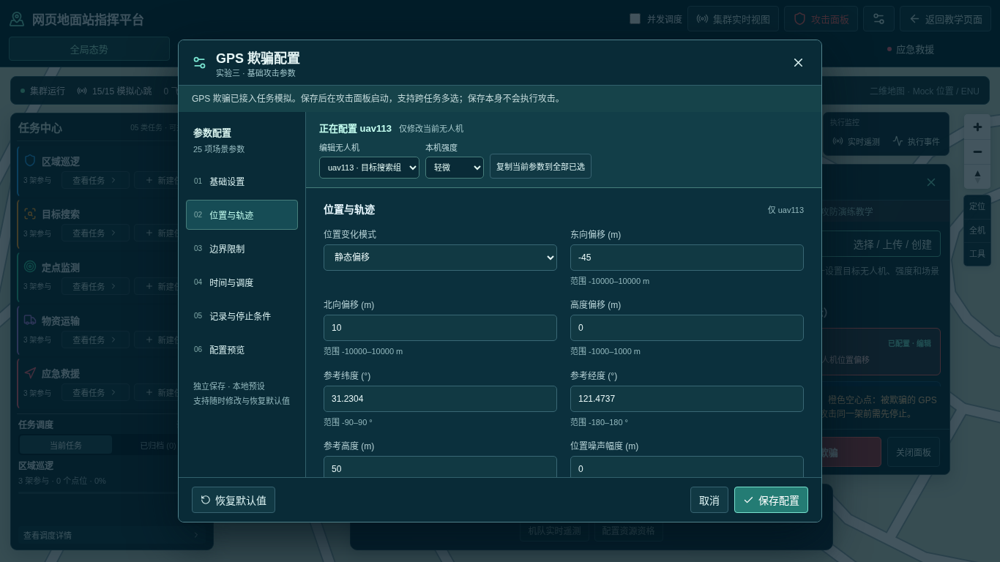
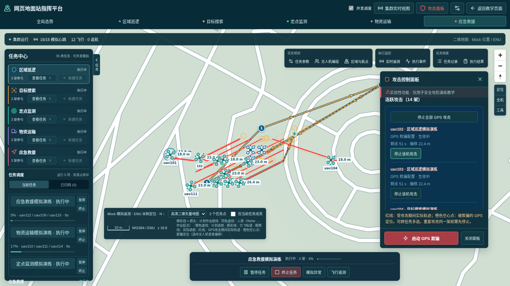
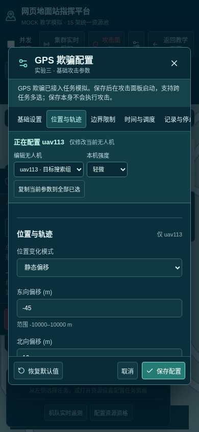

# 实验三：多无人机集群任务指挥

界面版本：2026 年 11 月 3 日。

入口：`/experiments/collaboration`。先启动统一前端，再通过“登录学生端”进入实验中心。

[返回全部实验](../README.md) · [运行与依赖说明](../../../README.md)

## 步骤 1：系统感知

检查运行环境，选择“进入教学模拟模式”。实验三当前通过前端 Mock 运行。

## 步骤 2：集群启动

启动模拟集群并检查 15 架无人机的启动状态。

## 步骤 3：通信组网

查看节点、链路和通信状态。

## 步骤 4：集群状态监控

检查机队资源、遥测、地图和事件。

## 步骤 5：多任务协同指挥

展开指挥台，配置资源和任务；支持区域巡逻、目标搜索、定点监测、物资运输、应急救援。生成计划、检查并部署，随后启动模拟执行。

## 步骤 6：实验评价

安全结束任务后查看实际模拟轨迹、任务指标与执行记录；结束任务不会关闭整个集群。

## GPS 欺骗：逐机配置与并发执行

1. 在指挥台打开“安全攻防演练”，点击“GPS 欺骗”。
2. 跨任务勾选攻击目标，通过顶部“编辑无人机”逐架设置独立参数。
3. 设置东向、北向和高度偏移、模式、强度、噪声、延迟、持续时间及边界条件。
4. 可将当前参数复制到全部已选目标，再逐机微调；在“配置预览”核对逐机对照表。
5. 保存后点击“启动 GPS 欺骗”。每架按自己的参数开始和结束，可逐机停止或全部停止。

偏移表示 GPS 上报位置与实际位置的差值。飞控修正可能导致实际飞机向相反方向偏移，并非直接指定实际飞行终点。实际受攻击轨迹标红，GPS 上报位置为橙色空心点；停止后保留历史红色轨迹。

[查看参数语义与验证说明](../../../MUVA_unified_full_student_v2_integrated/docs/collaboration-gps-simulation.md)

逐机窗口继续使用与攻击库一致的尺寸，窄屏可滚动编辑：

