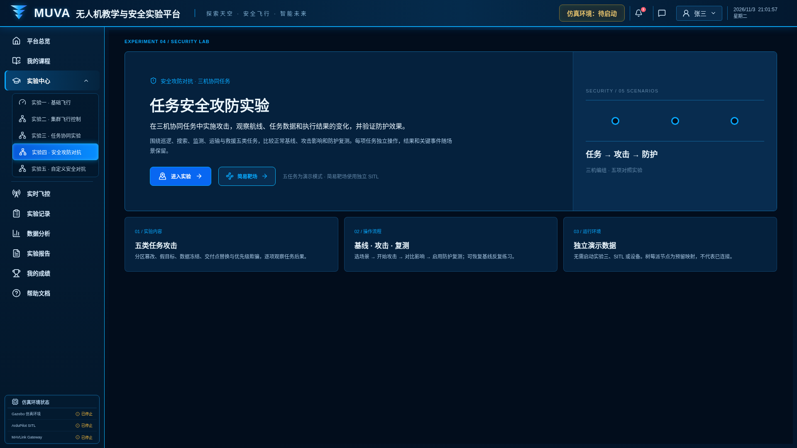
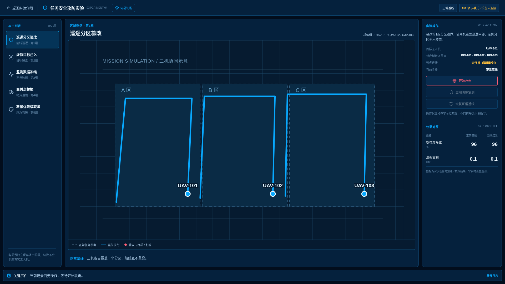
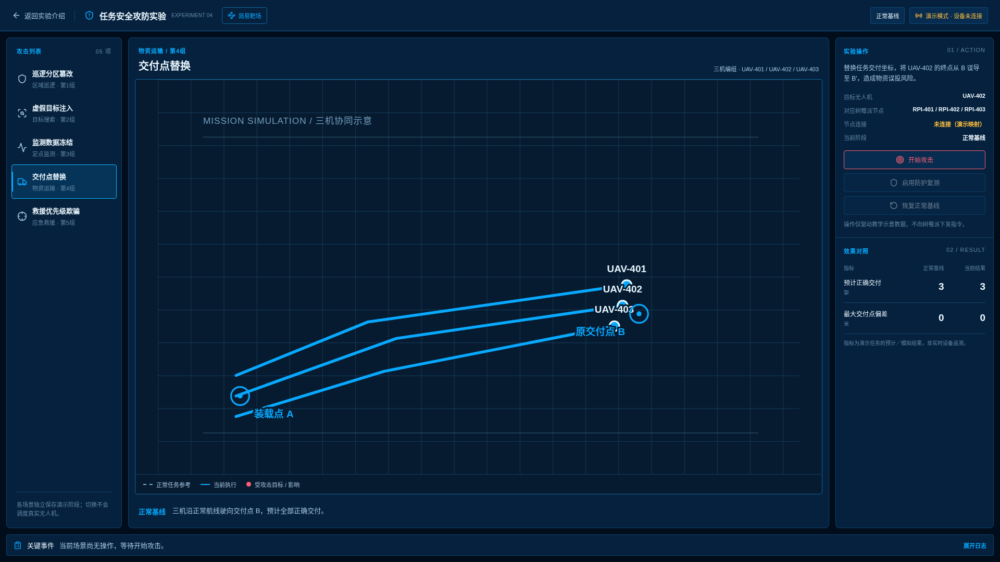
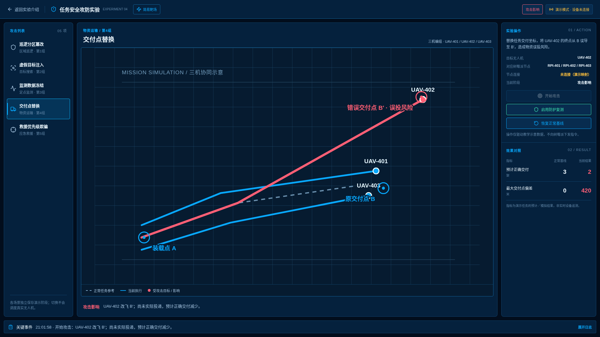
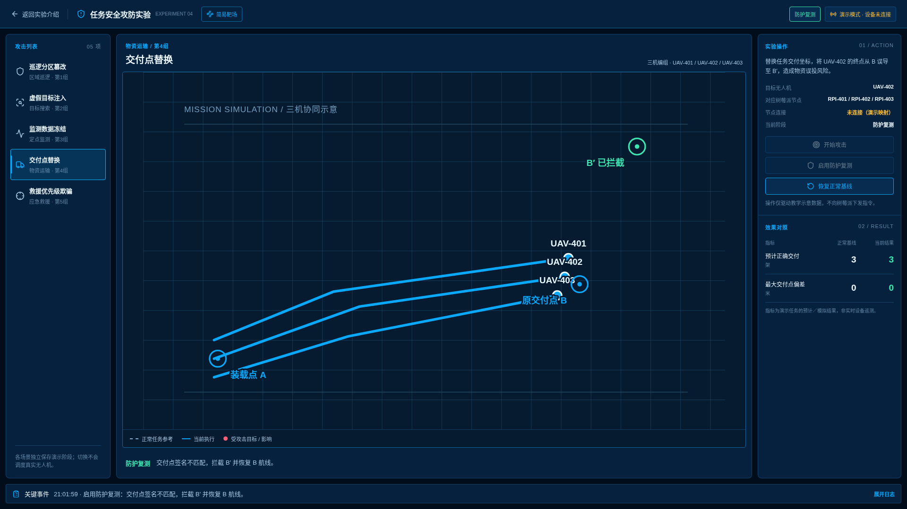

# 实验四：任务安全攻防实验

界面版本：2026 年 11 月 3 日。

入口：`/experiments/security`。先启动统一前端，再通过“登录学生端”进入实验中心。

[返回全部实验](../README.md) · [运行与依赖说明](../../../README.md)

## 步骤 1：实验介绍

阅读目标与操作流程，点击“进入实验”。

## 步骤 2：任务场景选择

进入独立工作区并选择任务安全场景。

## 步骤 3：正常基线

先运行正常任务，观察基线轨迹与状态。

## 步骤 4：攻击影响

启动模拟攻击，对比偏离轨迹和事件。截图来自运输场景。

## 步骤 5：防护与恢复验证

启用防护并验证恢复效果，结合事件进行复盘。任务场景为前端模拟；真实靶场需要独立仿真链路。

