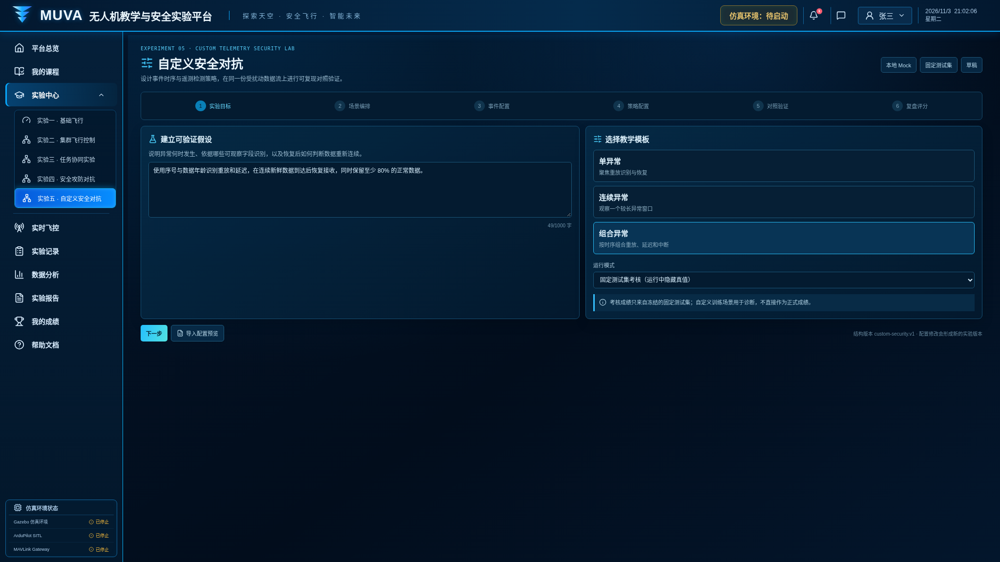
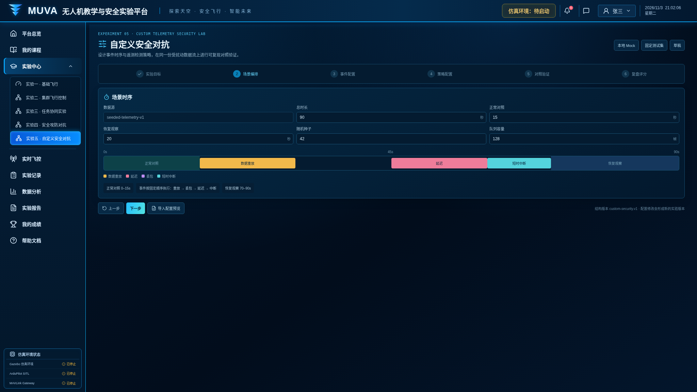
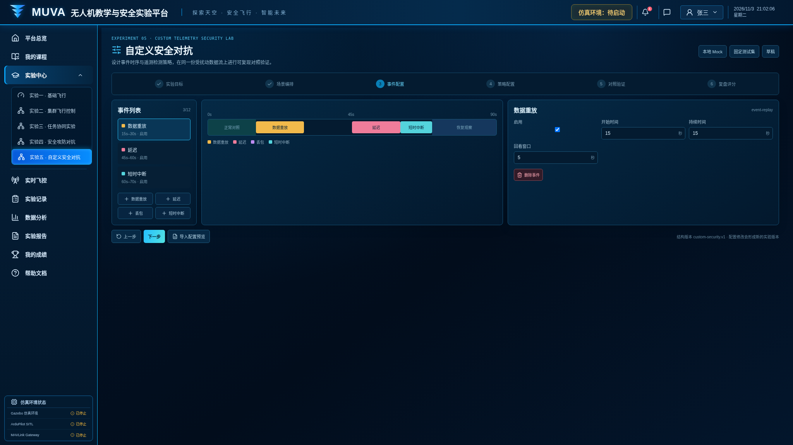
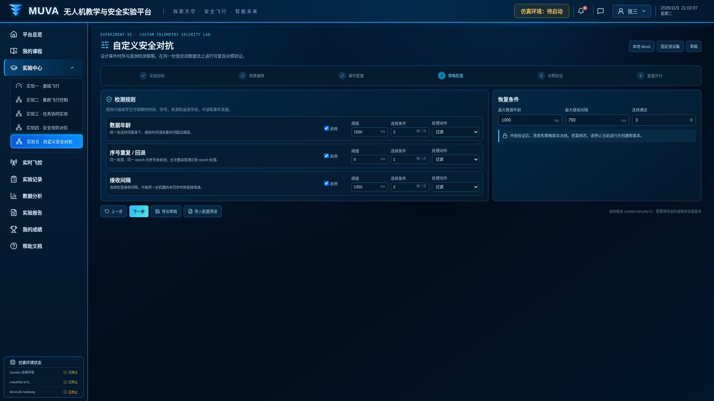
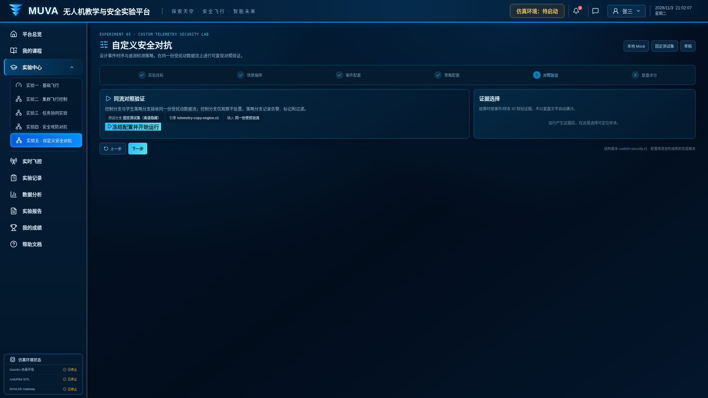
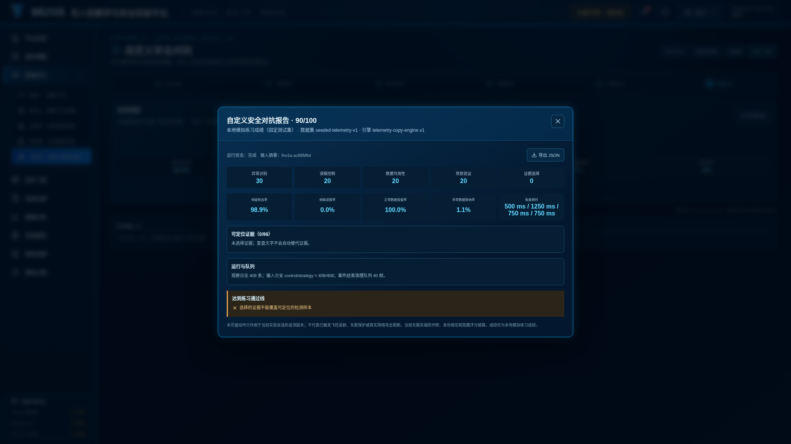

# 实验五：自定义安全对抗

界面版本：2026 年 11 月 3 日。

入口：`/experiments/custom-security`。先启动统一前端，再通过“登录学生端”进入实验中心。

[返回全部实验](../README.md) · [运行与依赖说明](../../../README.md)

## 步骤 1：实验目标

选择练习或考核模式，明确本次验证目标。

## 步骤 2：场景编排

设置训练场景与参与对象。

## 步骤 3：事件配置

配置模拟事件及触发条件。

## 步骤 4：策略配置

设置检测、防护及恢复规则。

## 步骤 5：对照验证

冻结配置并开始模拟运行，观察运行结果。

## 步骤 6：复盘评分

运行完成后结算，打开成绩报告；支持导出 JSON。

